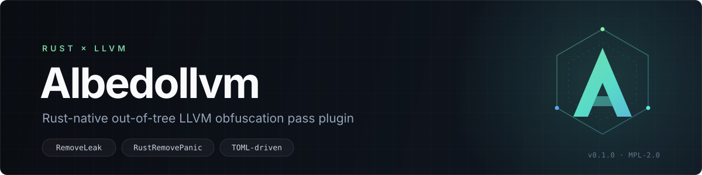

<p align="center">
  
</p>

<p align="center">
  <a href="LICENSE"></a>
  
  
  
</p>

<h1 align="center">Albedollvm</h1>

<p align="center">
  <strong>Rust 原生 LLVM 编译期加固和混淆插件</strong><br>
</p>

<p align="center">
  <code>RemoveLeak</code> · <code>RustRemovePanic</code> · <code>TOML</code> 配置 · 无运行时依赖
</p>

---

Albedollvm 是一个以 `cdylib` 形式构建的 LLVM 树外 Pass 插件，通过 rustc 的 `-Z llvm-plugins` 与 `-C passes=...` 接入 release 构建。它不修改源码、不引入运行时库，所有处理都发生在 LLVM IR 阶段。


> [!NOTE]
> 当前处于早期开发阶段。

## 特性

- **编译期生效** —— 作为 LLVM Pass 运行，目标程序无额外运行时依赖。
- **敏感字符串清理** —— 扫描模块中的常量字符串，按内置 / 自定义规则定位并等长覆写。
- **panic 痕迹移除** —— 掏空 panic 相关函数体，把直接调用点重定向到 `exit` 或 `llvm.trap`。
- **规则可配置** —— `ollvm.toml` 驱动，支持正则、长度窗口、子串预筛与内置规则覆盖。
- **多 ABI 符号理解** —— 共享符号解析层支持 Rust v0 / legacy、C++ Itanium / MSVC、Swift 名称。
- **可观测** —— 编译期日志可调级别与颜色，便于定位命中的函数和字符串。

## Pass 一览

| Pass | 短名 | 默认 | 作用 |
| --- | --- | --- | --- |
| `RemoveLeak` | `rl` | 启用 | 清理常量字符串中的路径、密钥、panic / backtrace 提示与运行时指纹 |
| `RustRemovePanic` | `rp` | 启用 | 移除 Rust panic 函数体与直接调用点，按配置终止进程 |


### RemoveLeak (`rl`)

对模块内 `ConstantDataArray` 形式的字符串常量做四级漏斗扫描：

1. 全局长度窗口快筛
2. 单规则长度窗口
3. 零分配子串预筛
4. 正则精确匹配

命中后写时复制到临时缓冲区，用随机小写字母等长覆写，再写回全局常量；同时清空模块的 `source_filename`。长度与布局保持不变，不会破坏依赖字符串长度的代码。

内置规则（`enable_builtins = true`）：

| 规则 | 目标 |
| --- | --- |
| `HomeDir` | 当前用户主目录路径 |
| `RustcLibrary` | `/rustc/<hash>/library/...` 标准库构建路径 |
| `SrcPath` | `src/...rs` 源码路径 |
| `RustPanicAndBacktrace` | `panicked at`、`RUST_BACKTRACE`、`assertion failed` 等提示 |
| `TokioRuntimeFingerprint` | Tokio 工作线程名、`TOKIO_*` 环境变量等指纹 |

自定义规则与内置规则同名时会覆盖内置规则。

### RustRemovePanic (`rp`)

1. 对函数名做 demangle，并用内置正则识别 panic / unwind / assert 相关符号。
2. 清空目标函数体，替换为对 `exit(code)` 或 `llvm.trap()` 的终止调用，并标记 `noreturn`、`nounwind`、`cold`，内部化符号。
3. 扫描剩余直接调用点（`call` / `invoke` / `callbr`），在调用前插入终止调用，并把原指令改为 `unreachable`。
4. 注册管线时追加 `ADCE` 与 `GlobalDCE`，回收被掏空的函数与死代码。

`mode = "trap"` 在 x86 上通常落地为 `ud2`，在 AArch64 上为 `brk`；`mode = "exit"` 调用 C 标准库 `exit(exit_code)`。


## 配置

插件按以下顺序查找配置：

1. 环境变量 `OLLVM_CONFIG` 指向的文件
2. 当前工作目录下的 `ollvm.toml`
3. 都没有时使用内置默认值

示例：

```toml
[rust_remove_panic]
enabled = true
mode = "trap"
exit_code = 101

[remove_leak]
enabled = true
enable_builtins = true

[[remove_leak.rules]]
name = "InternalSecretKey"
min_len = 24
max_len = 256
substrings = ["sk-live-", "sk-test-"]
regex = '(sk-(?:live|test)-[0-9a-zA-Z]{16,64})'

[[target_func.rules]]
func = "mix64"
path = ["demo"]
pass = ["pass2", "pass3"]  # 对该函数应用这两个pass
exclude = false            # 控制是排除还是启用

[[target_func.rules]]
path = ["lib_unknown", "core"]
# 空pass表示应用全部pass

[[target_func.rules]]
func = "rpp64"
path = ["lib_unknown", "core"]
pass = ["pass3"]
exclude = true             # 在 core 中单独为 rpp64 排除 pass3

[target_func.pass1]        # 对其他未明确选择的函数按概率启用该pass
other_pct = 10             # 0..=100

[target_func.pass2]
other_pct = 0

[target_func.pass4]
other_pct = 100
```

## 测试

```bash
cargo test
```

测试覆盖两层：

- **IR 级测试**：通过 `opt-22` 加载插件、运行指定 Pass，检查输出 IR 与日志。
- **Cargo 端到端测试**：使用 `nightly-2026-04-02` + `-Z build-std` 编译 `tests/demo/atest`，验证同步 / Tokio 异步控制流、panic 终止与字符串擦除。


## 项目结构

```text
.
├── src/
│   ├── lib.rs                    # 插件入口与 Pass 管线注册
│   ├── all_pass/
│   │   ├── remove_leak.rs        # RemoveLeak Pass
│   │   └── rust_remove_panic.rs  # RustRemovePanic Pass
│   └── utils/
│       ├── conf.rs               # TOML 配置加载与合并
│       ├── conf/                 # 各 Pass 配置、符号匹配
│       ├── logger.rs             # 编译期日志
│       └── predicates.rs         # 不透明谓词构造（预留）
├── tests/
│   ├── demo/                     # IR 与 Cargo 演示工程
│   ├── test_remove_leak.rs
│   └── test_rust_remove_panic.rs
├── assets/banner.svg
├── ollvm.toml                    # 示例配置
├── LICENSE
└── README.md
```

## 许可证

本项目采用 [Mozilla Public License 2.0](LICENSE)（MPL-2.0）。

